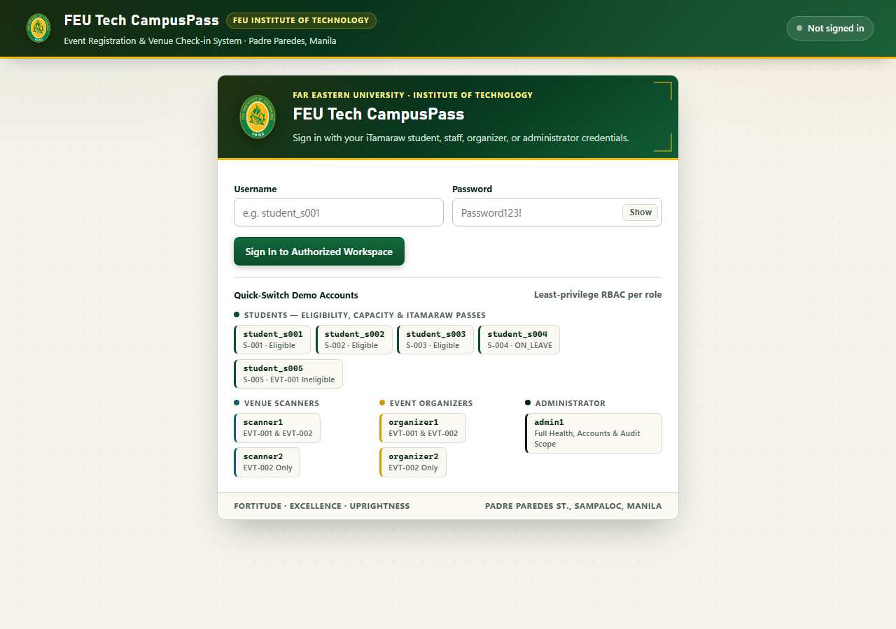
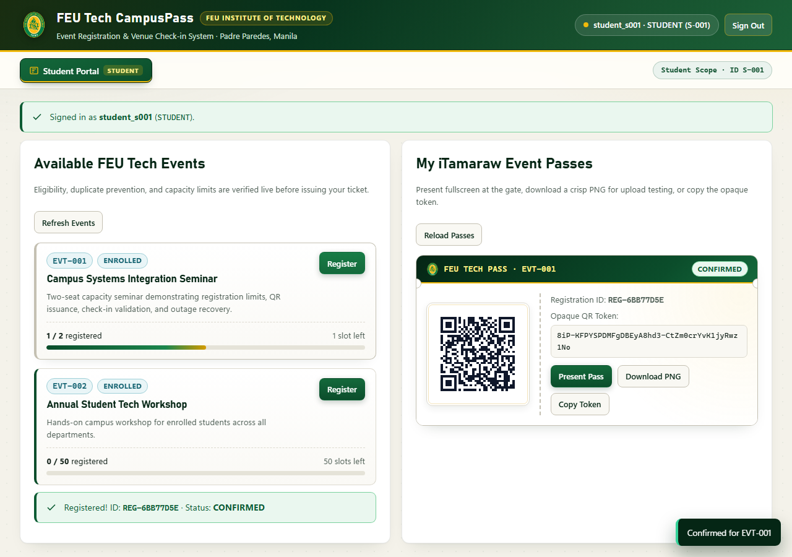
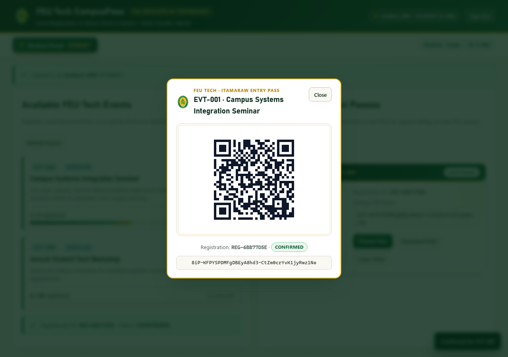
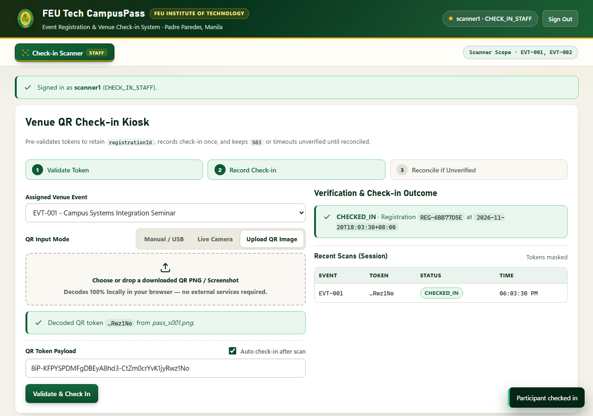
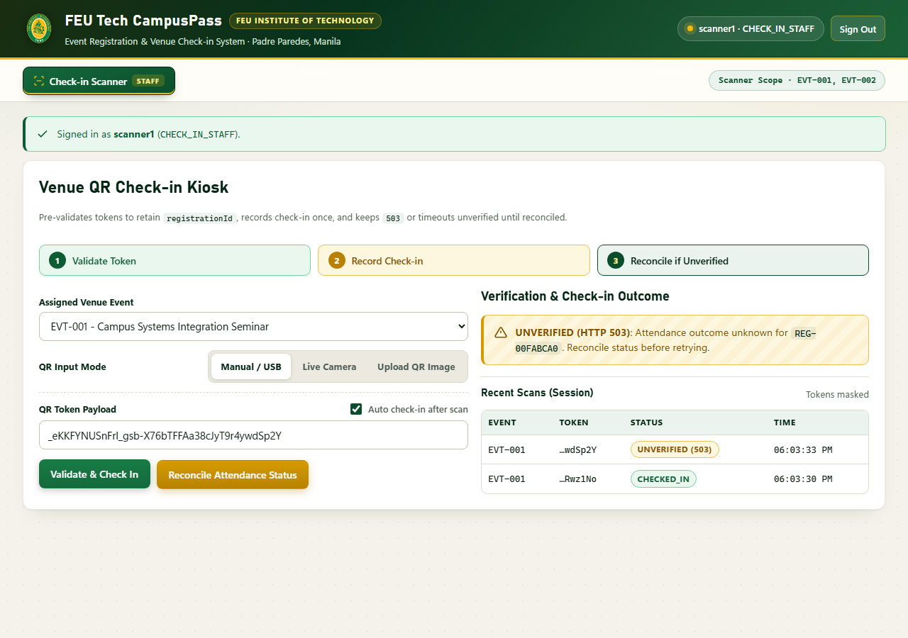
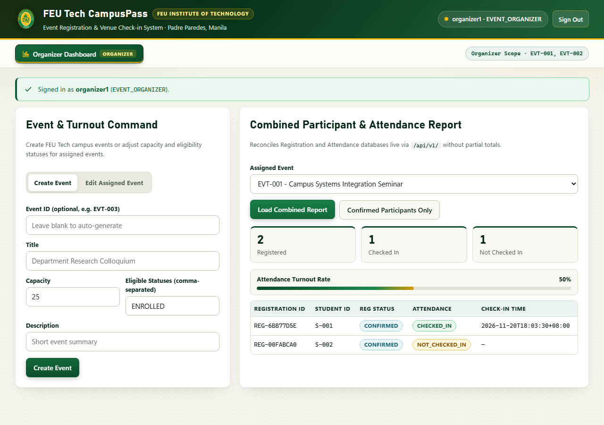
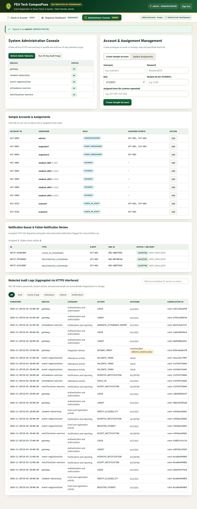
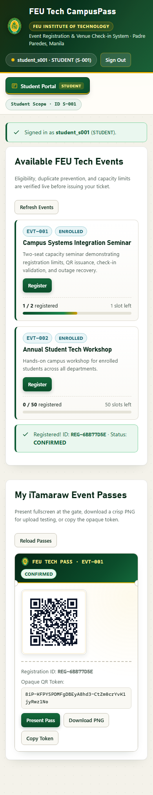

# FEU Tech CampusPass — Integrated Campus Event Registration and Attendance System

Prototype implementation for **IT0129 Systems Integration and Architecture 2** matching `Proposal - With In Progress Revisions.docx.pdf` **1:1** across five isolated HTTPS microservices, versioned `/api/v1/` JSON contracts, strict role-gated UI & API RBAC, automatic audit redaction, bounded retries, outage reconciliation (`FP 2`), and Section 10 verification evidence.

## Team Members

- Vaughn Djester Caringal
- JT Alexander Escudero
- Jiro Dotillos
- David Marcellus Credo
- Romeo Andree Bundalian

---

## Visual System Showcase

### 1. Exclusive Role-Gated Sign-In Gate
Unauthenticated visitors see only the Sign-In gate (no navigation rail or workspace tabs are exposed until authenticated, and users must sign out before switching accounts).



### 2. Student Portal & Perforated iTamaraw Digital Boarding Pass (`STUDENT`)
Displays live event capacity meters, enforces `Student`-only registration (`CT 1` eligibility & `CT 2` capacity/uniqueness), and issues scannable SVG/PNG QR passes with opaque HMAC/Fernet tokens.



### 3. Fullscreen Gate Entry Pass Modal
High-contrast fullscreen pass presentation for live webcam scanning at the venue gate.



### 4. Venue QR Check-in Kiosk — Multi-Mode Scanning (`CHECK_IN_STAFF`)
Supports **Manual / USB Scanner Wedge**, **Live Camera** (`getUserMedia` + `BarcodeDetector` + pure-JS ISO 18004 Reed-Solomon pixel decoder fallback), and **100% Local Browser QR PNG Upload**, pre-validating tokens (`IT 1`), blocking duplicate scans (`FP 1` `409 ALREADY_CHECKED_IN`), and recording masked session history.



### 5. Live Attendance Service Outage & Safe Reconciliation (`FP 2`)
When `attendance-service` (`:8443`) is unreachable, the scanner retains the pre-validated `registrationId`, surfaces **`UNVERIFIED (HTTP 503)`**, and locks retry behind **Reconcile Attendance Status** (`GET /api/v1/events/{eventId}/registrations/{registrationId}/attendance`) before permitting a single controlled retry.



### 6. Event & Turnout Command (`EVENT_ORGANIZER`)
Scoped to the organizer's assigned events (`EVT-001`, `EVT-002`); supports creating and editing events (`POST /api/v1/events`, `PUT /api/v1/events/{eventId}`) and reconciles authoritative registrations with check-in records (`GET /api/v1/events/{eventId}/reports/attendance`).



### 7. System Administration Console (`ADMINISTRATOR`)
Probes all five HTTPS microservices in parallel, manages sample accounts and event assignments, monitors the asynchronous `HTTP 202` notification queue and failed-notification review feed, and filters aggregated redacted audit logs with 30-day retention purge.



### 8. Mobile Responsive Layout (`390×844` Viewport)
Single-column responsive layout with 44px touch targets and zero horizontal overflow across all five views.

<p align="center">
  
</p>

---

## Architecture (Zero Cross-Component Database Access)

```text
Browser / Clients ──HTTPS──▶ API Gateway & Auth (:8440, data/gateway_auth.db)
                               ├──▶ Student Directory     (:8441, data/student_directory.db)
                               ├──▶ Event Registration    (:8442, data/event_registration.db)
                               │       ├──▶ Student Directory (eligibility)
                               │       └──▶ Notification Service (async 202)
                               ├──▶ Attendance Service    (:8443, data/attendance.db)
                               │       ├──▶ Event Registration (validate & confirmed list)
                               │       └──▶ Notification Service (async 202)
                               └──▶ Notification Service  (:8444, data/notification.db)
```

Each component owns its own SQLite WAL database (`BEGIN IMMEDIATE` + unique constraints) and communicates exclusively via documented HTTPS/JSON interfaces under `/api/v1/` with `X-Correlation-Id` propagation, service-to-service credentials, and signed user context headers.

## Quickstart (Local HTTPS Cluster + Web UI)

1. Bootstrap local TLS certificates (`runtime/certs/`) and cryptographic keys (`runtime/secrets.env`):
   ```powershell
   python scripts/init_runtime.py
   ```
2. Launch all five HTTPS microservices and the local Web Prototype UI:
   ```powershell
   python scripts/run_all.py
   ```
3. Open `https://127.0.0.1:8440/` in your browser (accept the local self-signed development root CA warning or import `runtime/certs/ca.crt`).

### Sample Prototype Accounts

| Username | Password | Role | Notes |
| :--- | :--- | :--- | :--- |
| `student_s001` | `Password123!` | `STUDENT` | `S-001` (`ENROLLED`, eligible for `EVT-001` & `EVT-002`) |
| `student_s002` | `Password123!` | `STUDENT` | `S-002` (`ENROLLED`, eligible) |
| `student_s003` | `Password123!` | `STUDENT` | `S-003` (`ENROLLED`, hits `EVT-001` capacity=2 limit) |
| `student_s004` | `Password123!` | `STUDENT` | `S-004` (`ON_LEAVE` -> `422 INELIGIBLE`) |
| `student_s005` | `Password123!` | `STUDENT` | `S-005` (`ENROLLED`, ineligible for `EVT-001`) |
| `scanner1` | `Password123!` | `CHECK_IN_STAFF` | Assigned to `EVT-001` & `EVT-002` |
| `scanner2` | `Password123!` | `CHECK_IN_STAFF` | Assigned to `EVT-002` only (cross-event RBAC check) |
| `organizer1` | `Password123!` | `EVENT_ORGANIZER` | Assigned to `EVT-001` & `EVT-002` |
| `organizer2` | `Password123!` | `EVENT_ORGANIZER` | Assigned to `EVT-002` only (cross-event RBAC check) |
| `admin1` | `AdminPassword123!` | `ADMINISTRATOR` | Full account, health, notification & audit log access |

## Verification & Section 10 Evidence

- Run the full automated test suite (unit, CT 1–2, IT 1–2, FP 1–2, security/RBAC, live multi-process HTTPS E2E, and Playwright UI click-through smoke suite):
   ```powershell
   python -m pytest -v
   ```
- Regenerate Section 10 evaluation artifacts:
   ```powershell
   python scripts/generate_evidence.py
   ```

### Key Artifacts & Documentation

- OpenAPI 3.1.1 Contract: [contracts/openapi.yaml](contracts/openapi.yaml)
- JSON Schemas & Shared Fixtures: `contracts/schemas/`, `contracts/fixtures/`
- Legacy SIS Compatibility Guide: [docs/legacy-adapter-guide.md](docs/legacy-adapter-guide.md)
- Sprint & Definition of Done Log: [docs/sprint-log.md](docs/sprint-log.md)
- Section 10 Test Results (`38 passed`): [evidence/test-results.md](evidence/test-results.md)
- Section 10 Sample Redacted Logs: [evidence/sample-request-response-logs.md](evidence/sample-request-response-logs.md)
- Section 10 Registration vs Attendance Comparison: [evidence/registration-vs-attendance-comparison.md](evidence/registration-vs-attendance-comparison.md)
